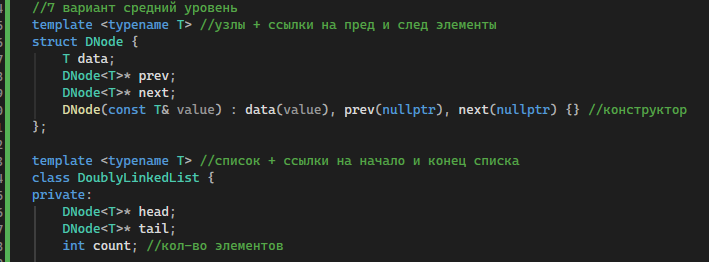
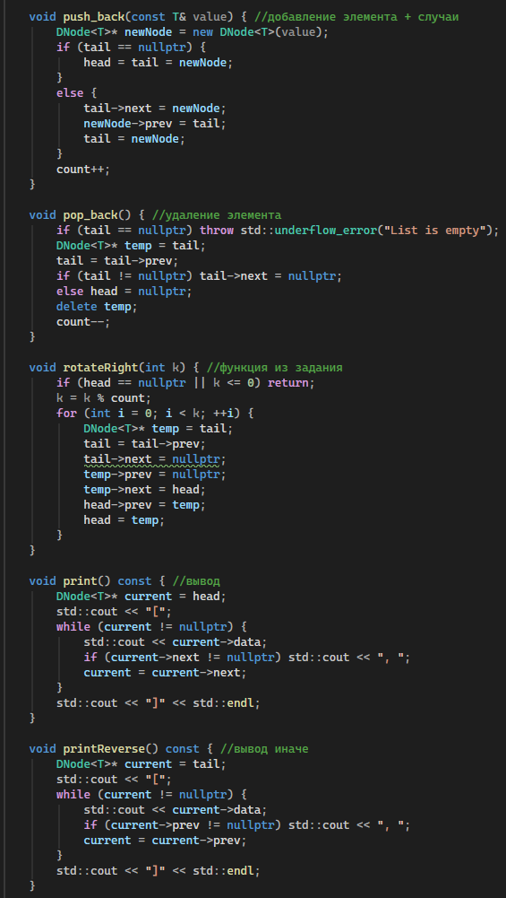
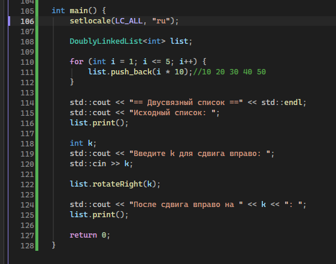
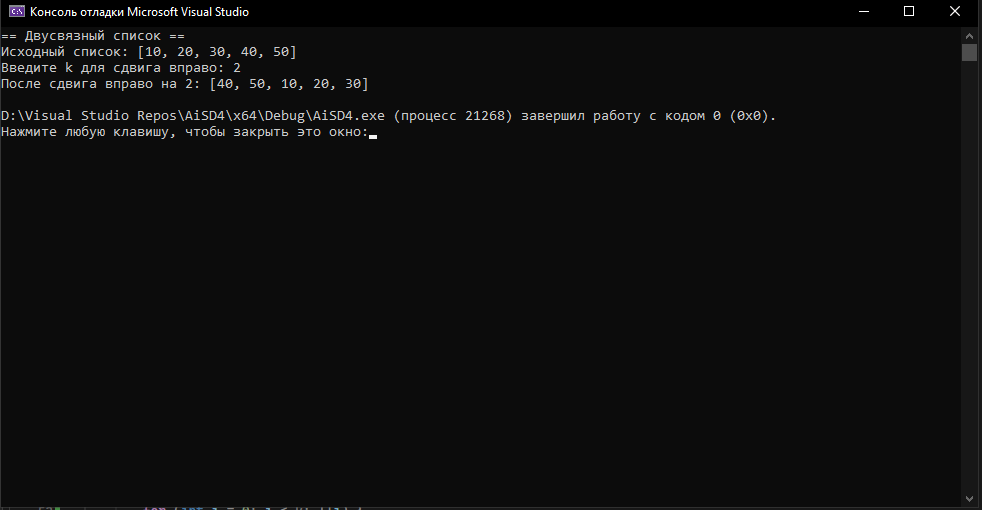

# Отчет к лабораторной работе № 4
# Тема: Односвязный и двусвязный списки
# Дисциплина: Алгоритмы и структуры данных
## Выполнил: Бойко Андрей Сергеевич ПИЖ-б-о-25-2
# Цель:
Цель работы: 
1. Реализовать шаблонный класс односвязного (SinglyLinkedList) с базовыми операциями 
2. Реализовать шаблонный класс списка двусвязного (DoublyLinkedList) с базовыми операциями 
3. Освоить операции вставки, удаления, поиска и обхода элементов в списках 
4. Сравнить производительность и особенности использования односвязного и двусвязного списков 
5. Научиться правильно управлять памятью при работе со списками (удаление узлов)
# Ход работы

Для начала создал шаблонные блоки с конструкторами узла и списка.

Прописал базовые функции для списка (push, pop, +вспомогательные) и функцию средней сложности rotateRight

Для демонстрации работы кода написал функцию main и в ней использовал напи

Запустил программу, проверил, что всё работает.
# Вывод:
1. Реализовали шаблонный класс односвязного (SinglyLinkedList) с базовыми операциями 
2. Реализовали шаблонный класс списка двусвязного (DoublyLinkedList) с базовыми операциями 
3. Освоили операции вставки, удаления, поиска и обхода элементов в списках 
4. Сравнили производительность и особенности использования односвязного и двусвязного списков 
5. Научились правильно управлять памятью при работе со списками (удаление узлов)
# Ответы на контрольные вопросы:
1. Чем связный список отличается от динамического массива?
Динамический массив хранит элементы в памяти непрерывно, что позволяет мгновенно получать к ним доступ по индексу. Связный список размещает элементы вразброс, связывая их указателями, поэтому доступ по индексу требует перебора. Зато вставка и удаление элементов в списке не требуют сдвига всех остальных данных, как в массиве.
2. Какие операции в односвязном списке выполняются за O(1)?
За константное время выполняются вставка и удаление в начале списка, так как для этого достаточно изменить указатель head. Также за O(1) работает вставка в конец, но только при условии, что в классе хранится отдельный указатель tail на последний элемент.
3. Почему удаление из конца односвязного списка требует O(n) времени?
В односвязном списке каждый узел знает только о следующем элементе, но не о предыдущем. Чтобы корректно удалить последний узел, нужно найти предпоследний и обнулить его указатель next. Для этого придется пройти весь список с самого начала.
4. Какие преимущества даёт хранение указателя tail в односвязном списке?
Указатель tail позволяет мгновенно получить доступ к последнему элементу списка. Благодаря этому операция добавления нового элемента в конец (push_back) начинает работать за O(1), а не за O(n), что значительно ускоряет работу.
5. Чем двусвязный список отличается от односвязного?
Главное отличие — наличие в узле двусвязного списка второго указателя (prev), который смотрит на предыдущий элемент. Это позволяет обходить список в обоих направлениях и упрощает удаление элементов. Однако за это приходится платить дополнительной памятью под хранение второго указателя.
6. Какие операции в двусвязном списке выполняются быстрее, чем в односвязном?
В двусвязном списке за O(1) выполняется удаление из конца (pop_back), так как мы сразу имеем доступ к предпоследнему узлу через tail->prev. Также быстрее происходит удаление или вставка перед заданным узлом, если у нас есть указатель на этот узел.
7. Что такое «голова» (head) и «хвост» (tail) списка?
«Голова» (head) — это указатель на самый первый узел в списке, именно с него начинается любой обход. «Хвост» (tail) — это указатель на последний узел, у которого указатель next равен nullptr. Эти два указателя служат точками входа для управления списком с обоих концов.
8. Как удалить узел из середины односвязного списка?
Сначала нужно найти узел, который стоит перед удаляемым (это займет O(n) времени). Затем необходимо перекинуть его указатель next через удаляемый узел на следующий за ним. После этого можно безопасно освободить память удаляемого узла.
9. Как удалить узел из середины двусвязного списка? Почему это проще?
Если у нас есть указатель на удаляемый узел, мы можем сделать это за O(1), не начиная обход с начала. Для этого достаточно связать соседние узлы напрямую: node->prev->next = node->next и node->next->prev = node->prev. Это проще, так как мы имеем прямой доступ к предыдущему элементу.
10. Что произойдёт, если забыть обновить tail при удалении?
Если удалить последний узел и не перевести указатель tail на новый конец списка, он будет указывать на уже освобожденную память. Это приведет к появлению «висячего» указателя, и любая следующая попытка добавить элемент или вывести список вызовет ошибку или аварийное завершение программы.
11. Как реализовать реверс односвязного списка?
Нужно пройти по списку, используя три указателя: на предыдущий узел, текущий и следующий. На каждом шаге мы меняем направление указателя next у текущего узла так, чтобы он смотрел на предыдущий. Затем сдвигаем все три указателя на один шаг вперед, пока не дойдем до конца.
12. Как обнаружить цикл в связном списке?
Самый популярный способ — использовать алгоритм «черепахи и зайца» (алгоритм Флойда). Запускаются два указателя: один двигается по одному узлу за шаг, а второй — по два. Если в списке есть цикл, «заяц» рано или поздно догонит «черепаху» и они встретятся на одном узле.
13. В каких случаях стоит использовать список вместо массива?
Список стоит выбирать, если планируется много операций вставки и удаления в середине или начале структуры. Также он удобен, когда заранее неизвестен точный размер данных. Если же требуется частый и быстрый доступ к элементам по их индексу, лучше использовать массив.
14. Какая дополнительная память требуется для каждого узла списка?
Помимо самих данных, каждый узел односвязного списка хранит один указатель на следующий элемент (обычно 8 байт на 64-битных системах). В двусвязном списке узел хранит уже два указателя (на следующий и предыдущий элементы), что удваивает накладные расходы на память.
15. Почему доступ по индексу в списке имеет сложность O(n)?
В отличие от массива, элементы списка не лежат в памяти подряд, поэтому нельзя вычислить адрес нужного элемента по формуле. Единственный способ добраться до элемента с номером i — начать с головы (head) и последовательно перейти по указателям next ровно i раз. Из-за этого время доступа растет линейно с размером списка.
